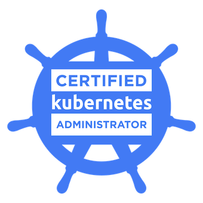
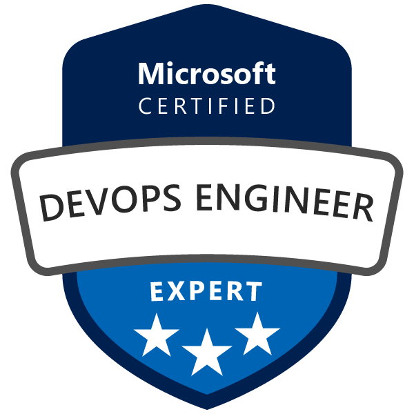
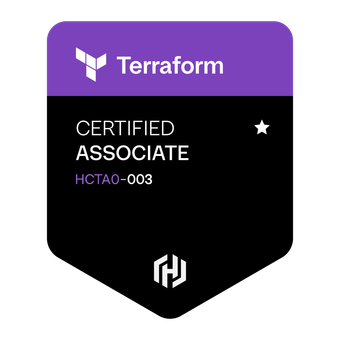

# Abdur Rahman Habib

**DevOps Engineer** · AWS · Azure · GCP · Kubernetes · Terraform · GitOps · DevSecOps

DevOps Engineer with 3.5+ years of experience building, securing, and running production platforms on AWS, Azure, and GCP. I lead a DevOps and DevSecOps team at CloudQuik, working across Kubernetes, Terraform, Argo CD, GitHub Actions, and cloud security.

- Reduced AWS costs by 25–35% through rightsizing, autoscaling, Spot Instances, and Savings Plans
- Architected multi-account AWS environments and Azure landing zones with Terraform
- Run GitOps delivery with Argo CD and reusable GitHub Actions pipelines with blue-green and canary releases
- Secure the software supply chain with SonarQube, Trivy, Snyk, Gitleaks, and least-privilege IAM
- Operate 24/7 production with Prometheus, Grafana, Loki, Tempo, and OpenTelemetry

## Certifications

  
  
  
  
  

## Tech Stack

| Area | Tools |
| --- | --- |
| Cloud | AWS (EKS, ECS, Lambda, RDS, MSK, Organizations), Azure (AKS, App Service, Front Door), GCP (GKE, Cloud Run) |
| Containers | Kubernetes, Docker, Helm, Kustomize, Karpenter |
| CI/CD & GitOps | GitHub Actions, Jenkins, GitLab CI/CD, Azure DevOps, Argo CD, Flux CD |
| IaC & Config | Terraform, Terragrunt, CloudFormation, Bicep, Ansible |
| Security | IAM, Vault, Secrets Manager, Key Vault, SonarQube, Trivy, Snyk, Gitleaks, OPA |
| Observability | Prometheus, Grafana, Loki, Tempo, Thanos, OpenTelemetry, ELK, Datadog, CloudWatch |
| MLOps & AI | Amazon SageMaker, Amazon Bedrock, Azure OpenAI, Apache Airflow |
| Scripting | Python, Bash, PowerShell, Linux |

## Connect

[LinkedIn](https://www.linkedin.com/in/abdurrahman-habib/)
